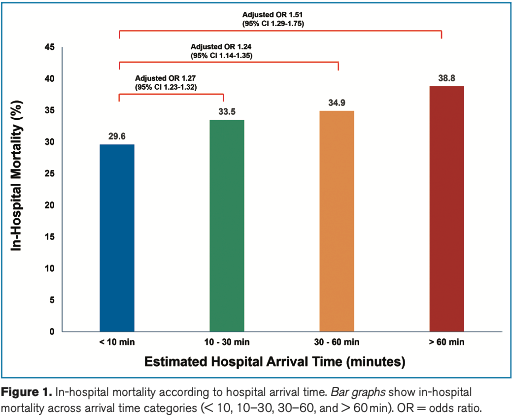

## Glossary
- **Cardiogenic Shock(CS)** : 심인성 쇼크, 심장의 펌프 기능이 급격히 저하되어 신체 각 조직과 장기로 충분한 혈액과 산소를 공급하지 못하는 치명적인 응급 상황
- **Prehospital delay** : 응급 질환의 증상 발생부터 병원 응급실에 도착하기까지 걸리는 시간적 지연

## Glossary
- De novo : 새롭게
- Acute-on-Chronic : 만성 질환이 갑작스러운 악화 요인에 의해 급격히 나빠진 상태
- Prognosis : 예후


## Background

- CS는 심장기능 저하로 조직 관류가 감소하는 중증 응급질환으로, 30일 사망률이 50% ↑⇧
- 비가역적 장기부전을 예방하고 생존율을 높이려면 신속하게 전문 치료를 시작해야 함
- 기존 연구는 주로 재관류술과 기계적 순환보조 등 병원 내 치료 지연에 집중했다.
- 병원 도착 전 접근시간의 지역 차이가 심인성 쇼크 환자의 사망률과 관련되는지는 충분히 연구되지 않았다.


## Research Question

>상급종합병원까지의 지역별 접근시간이 <br>
>CS 환자들의 병원 내 및 장기 사망률과 연관이 있는가?


# METHOD


## PICO

| 구분 | 요약 |
|:---|:---|
| Population | 2017–22년 상급종합병원 ICU에 입원한 18세 이상 CS 환자 |
| Exposure | 거주지역에서 상급종합병원까지의 추정 접근시간 <br> (10–30분, 30–60분, >60분) |
| Comparison | 추정 접근시간 <10분 |
| Outcome | 1년 all-cause mortality; <br> 병원 내 사망 및 전체 추적기간 all-cause mortality |

## Study Design

- 한국국민건강보험공단(NHIS) 데이터베이스
- 한국교통연구원의 지역 병원 접근성 지표


## Patients

::: panel-tabset

### 포함기준

- 2017–2022년 상급종합병원 ICU에 새로 입원한 18세 이상 환자
- 병원 밖에서 발생한 cardiogenic shock
- 진단코드와 치료내역을 조합한 claims-based definition 적용
- 최종 분석 대상: 80,263명


### 제외기준
- Anaphylaxis
- 이전 shock 병력(118,259명)
- 거주지역과 입원 병원의 행정구역이 다른 환자


:::


## CS 진단 알고리즘 검증

::: panel-tabset

### 요약

- 건강보험자료에는 CS를 임상적으로 확진할 정보 부족
- 진단코드 + 치료내역 조합하여 CS 정의

### 확인

- 검증 대상 : 병원 기반 코호트 10,156명
- 실제 CS로 판정한 환자 2,104명(21%) 기준으로 알고리즘 검증
 - 민감도 : 0.89 (95% CI, 0.86–0.92)
 - 특이도 : 0.90 (95% CI, 0.88–0.93)

:::

## 병원 도착 시간 계산

- 환자의 거주 행정구역 → 가장 가까운 상급종합병원
- **평균 주간 승용차 이동시간**으로 병원 접근시간을 추정 <br> by 인구 및 주택 조사, 국가 비즈니스 조사, 국가 교통 조사, 지리 정보 시스템 기반 도로망 지도 및 이동성 궤적 데이터

## primary endpoint

> 1년 추적 시 전체 사망률<br>
> (중위 추적 기간이 1.3년이고 사망이 첫 해에 집중)

## secondary endpoint

> 전체 추적 기간(5년) 동안 병원 내 사망률과 전체 사망률


## Statistical Analysis_1

```{mermaid}
flowchart TD
  A["지역별 추정 병원 접근시간<br/><10분, 10–30분, 30–60분, >60분"]
  A --> B["병원 내 사망"]
  A --> C["1년 및 최대 5년 전체사망률"]
  B --> D["Logistic regression"]
  D --> E["Adjusted OR와 95% CI"]
  C --> F["Kaplan–Meier curve"]
  F --> G["Log-rank test"]
  C --> H["Cox proportional hazards model"]
  H --> I["Adjusted HR와 95% CI"]
```

## Statistical Analysis_2

```{mermaid}
flowchart TD
  A["연속형 접근시간"] --> B["Restricted cubic spline"]
  B --> C["비선형 관계 평가"]

  D["사전 정의된 임상 특성"] --> E["Subgroup analysis"]
  E --> F["Interaction test"]

  G["생존 퇴원 환자"] --> H["Cox regression"]
  H --> I["퇴원 후 사망 분석"]

  J["PH assumption"] --> K["Schoenfeld residuals<br/>Log-minus-log plot"]
```
- 모든 검정은 양측 `P < 0.05`를 통계적 유의수준으로 적용


## Multivariable adjustment

::: panel-tabset

### 보정 이유

- 접근시간이 긴 지역의 환자가 더 고령이고 중증도가 높다면 사망률 차이가 접근시간 때문인지 환자 특성 때문인지 구분하기 어려움
- 여러 변수를 모델에 동시에 넣어 보정

### 이 연구의 보정변수

  - 나이
  - 성별
  - Charlson Comorbidity Index
  - 입원 연도
  - Multiple vasopressors
  - CPR
  - Mechanical ventilation
  - IABP
  - ECMO
  - CRRT
  
:::

# Results

## Study Population

- 최종 분석 대상: **80,263명**
- 추정 병원 접근시간 중앙값: **9.15분** (IQR 7.31–12.85)

| 추정 접근시간 | 환자 수 (%) |
|:---|---:|
| <10분 | 46,293 (57.7%) |
| 10–30분 | 29,644 (36.9%) |
| 30–60분 | 3,422 (4.3%) |
| >60분 | 904 (1.1%) |

- 접근시간이 긴 군에서 연령, 성별, 응급실 입원 및 일부 중환자 치료 변수의 SMD가 0.1 이상

## Primary Outcome: 1-Year Mortality

| 추정 접근시간 | 1년 사망률 | Adjusted HR (95% CI) |
|:---|---:|---:|
| <10분 | 41.4% | Reference |
| 10–30분 | 45.9% | 1.16 (1.14–1.19) |
| 30–60분 | 47.9% | 1.16 (1.09–1.21) |
| >60분 | 52.9% | 1.31 (1.19–1.43) |

- Kaplan–Meier curve의 군 간 차이: log-rank `P < 0.001`
- 다변수 Cox model에서도 접근시간이 긴 군에서 사망 hazard가 높게 나타남

## In-Hospital Mortality

::: panel-tabset

### table
| 추정 접근시간 | 사망률 | Adjusted OR (95% CI) |
|:---|---:|---:|
| <10분 | 29.6% | Reference |
| 10–30분 | 33.5% | 1.27 (1.23–1.32) |
| 30–60분 | 34.9% | 1.24 (1.14–1.35) |
| >60분 | 38.8% | 1.51 (1.29–1.75) |

### figure




:::

## Additional Analyses

- 최대 5년 사망, `>60분` vs. `<10분`: adjusted HR **1.33** (95% CI 1.22–1.44)
- 생존 퇴원자의 1년 사망, `>60분` vs. `<10분`: adjusted HR **1.21** (95% CI 1.01–1.44)
- Restricted cubic spline: 10–20분 부근에서는 큰 변화 x, 이후 증가하여 60분 이후 상승 폭이 커짐
- AMI 여부 및 shock chronicity에 따른 유의한 interaction은 관찰되지 않음

# Conclusion

## Strengths

- 전국 건강보험자료를 이용한 대규모 population-based cohort, `n = 80,263`
- 별도의 병원 기반 코호트에서 claims-based CS 알고리즘 검증
- 병원 내 사망, 1년 사망 및 최대 5년 사망을 함께 평가
- 접근시간을 범주형 및 연속형 restricted cubic spline으로 분석
- AMI 여부와 shock chronicity를 포함한 subgroup interaction analysis 시행

## Limitations_1: Exposure Measurement

- 개인별 실제 이송시간이 아닌 **거주지역 단위의 평균 접근시간** 사용
- 표준화된 주간 승용차 이동시간으로 실제 EMS 이동, 교통상황 및 병원 경유를 반영하지 못함
- 가장 가까운 상급종합병원까지의 추정시간과 실제 입원 병원까지의 이동시간이 다를 수 있음
- 증상 발생, 신고, 현장 처치 및 병원 도착 시각을 확인할 수 없음
- 결과는 개인별 prehospital delay보다 **지역의 상급종합병원 접근성**으로 해석해야 함

## Limitations_2: Study Design and Analysis

- 거주지와 다른 행정구역의 병원에 입원한 환자 38,295명 (32.3%) 제외
- 병원 도착 전 사망자는 포함되지 않아 선택 편향 가능
- Vital sign, lactate, cardiac output 및 SCAI shock stage 등 임상 중증도 정보 부재
- 지역 및 병원 clustering을 고려한 분석이 제시되지 않음
- 병원 규모, 치료량, EMS 자원 및 지역 특성에 대한 보정이 제한적
- CPR, ECMO 등 접근 지연 이후 발생할 수 있는 변수를 보정해 과잉조정 가능

## Take-Home Conclusion

> 상급종합병원까지의 **지역 평균 접근시간이 긴 지역**에 거주한 심인성 쇼크 환자에서 병원 내 및 장기 사망이 높게 나타났다.

- 60분 초과군의 병원 내 사망: adjusted OR 1.51 (95% CI 1.29–1.75)
- 60분 초과군의 1년 사망: adjusted HR 1.31 (95% CI 1.19–1.43)
- 실제 개인별 이송시간이 사망을 증가시켰다는 인과관계는 확인할 수 없음
- 연구결과는 지역별 응급의료 접근성 차이를 보여주는 health-services evidence로 해석
- 기사에서 제시한 “사망위험 1.5배”는 risk ratio가 아니라 병원 내 사망 odds ratio
