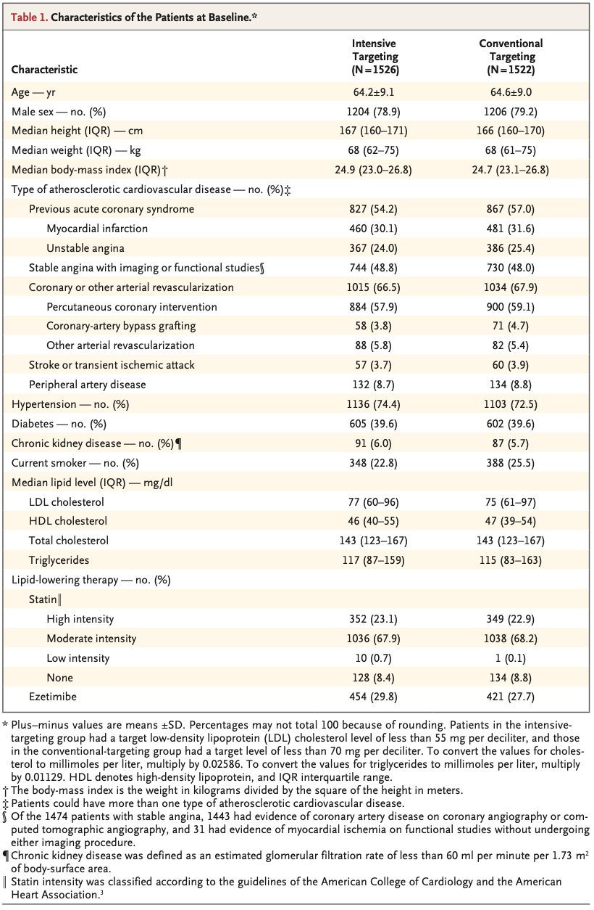
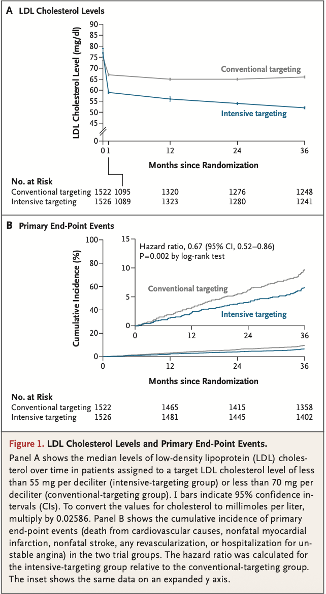
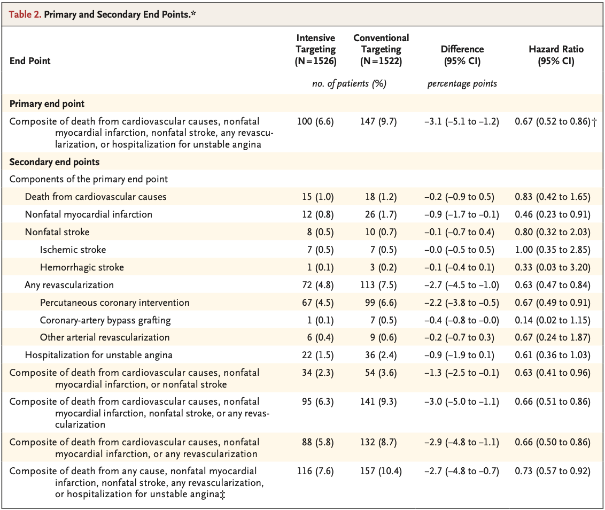
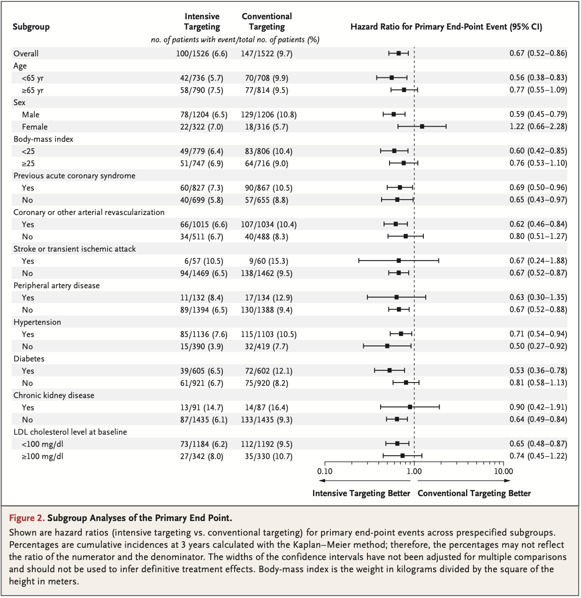
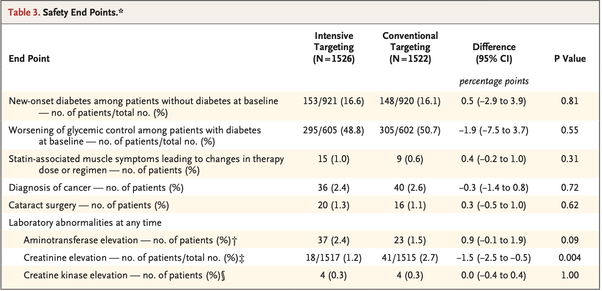

## Glossary
-   **Atherosclerotic cardiovascular disease(ASCVD)** :  
동맥경화성 심혈관질환; 죽상동맥경화로 인해 발생한 심혈관 질환군으로, 대개 이상지질혈증이 원인임. 관상동맥질환, 뇌혈관질환, 말초혈관질환, 대동맥류, 장허혈 등이 포함됨.  

-   **low-density lipoprotein cholesterol(LDL-C)** : 혈관 벽에 쌓여 동맥경화를 유발하는 콜레스테롤 

## Background

- ASCVD 환자에서 LDL-C 감소는 이차 예방의 핵심
- 최근 지침은 고위험 환자에게 LDL-C <55 mg/dL을 권고
- 그러나 <55 mg/dL과 <70 mg/dL 목표를 직접 비교한 연구는 부족

## Research Question

> ASCVD 환자에서 LDL-C <55 mg/dL을 목표로 하는 것이  
> <70 mg/dL 목표보다 심혈관 사건의 발생 위험을 감소시키는지 평가

# METHOD

## PICO

| 구분         | 요약                        |
|--------------|-----------------------------|
| Population   | ASCVD가 확인된 19–80세 환자 |
| Intervention | LDL-C 목표 <55 mg/dL        |
| Comparison   | LDL-C 목표 <70 mg/dL        |
| Outcome      | 주요 심혈관 사건            |
| Follow-up    | 3년                         |

## Study Design

- 무작위 open-label 우월성 시험
- 대한민국 17개 기관

## Patients

::: panel-tabset
### 포함기준
- ASCVD가 확인된 19–80세 환자
- 참여 조건: 관상동맥질환, 동맥경화성 심혈관 질환이 있는 경우
- 제외 경우: 스타틴 복용 없이 LDL-C가 이미 70 mg/dL 미만인 사람 

### 배정
- 총 3,048명
- 1:1 (i:c=1526:1522)

:::

## randomization
>permuted-block randomization  
>(with mixed blocks of 4 or 6)

- 블록 크기 4 또는 6을 혼합하여 사용
- 각 연구기관에서 두 군의 환자 수가 균형을 이루도록 배정
- 블록 크기를 혼합하여 다음 배정을 예측하기 어렵게 함
 

## primary endpoint
-  심혈관 원인에 의한 사망, 비치명적 심근경색, 비치명적 뇌졸중, 모든 재관류 또는 불안정 협심증에 대한 입원을 복합적으로 구성

## secondary endpoint

-   효능: primary endpoint의 개별 구성 요소, 심혈관 원인에 의한 사망, 비치명성 심근경색 또는 비치명성 뇌졸중을 포함한 추가 사전 지정 복합 endpoint

-   안전성: 신규 발병 당뇨병, 혈당 조절 악화, 스타틴 관련 근육 증상으로 인해 치료 용량이나 요법 변경, 암 진단, 백내장 수술, 아미노전이효소, 크레아티닌 또는 크레아틴 키나제 수치 상승

## Sample Size

|항목                 | 설정                 |
|---------------------|:---------------------|
|power(검정력)        | 80%                  |
|alpha(양측 유의수준) | 0.05                 |
|예상효과             | 상대위험 24.75% 감소 |
|예상 추적 손실률     | 15%                  |

## Statistical Analysis_1

  - **분석 방법** → Intention-to-treat(ITT)
  - **3년 누적 사건 발생률** → Kaplan–Meier 방법
  - **두 군의 발생률 비교** → Log-rank 검정
  - **치료 효과 추정** → Cox 비례위험 회귀모형
    - 위험비(HR)와 95% 신뢰구간 제시
  - **통계적 유의성** → 양측 `P<0.05`

## Statistical Analysis_2

  - **비례위험 가정 확인**
    - Schoenfeld 잔차 검정에서 위반 증거 없음 (`P=0.92`)

  - **민감도 분석**
    - 주요 프로토콜 위반자를 제외한 Per-protocol 분석
    - Fine–Gray 모형을 이용한 경쟁위험 분석

  - **추가 분석 원칙**
    - 결측값 대체 및 중간분석 미시행
    - 이차 결과와 하위집단 분석의 다중 비교 미보정
    - 따라서 이차·하위집단 결과는 탐색적으로 해석

# Results

## Baseline characteristic

::: panel-tabset

### 요약
- 2021.01-2022.07 한국의 환자 무작위 배정
- 두 군의 Baseline characteristic은 대체로 균형을 이루었음
- 환자들의 평균 연령 64.4세, 여성 20.9%, LDL-C 수치 중앙값 76 mg/dL

### Table1

:::

## Primary Outcome

::: panel-tabset

### LDL-C 및 일차 복합 결과

| 결과           | Intensive | Conventional |
|----------------|----------:|-------------:|
| LDL-C 중앙값   |  56 mg/dL |     66 mg/dL |
| 3년 누적 발생률|      6.6% |         9.7% |

- HR 0.67 (95% CI 0.52–0.86)
- 치료효과검정 P=0.002
- 절대위험감소(ARR): 약 3.1%p
- 3년 치료필요수(NNT): 약 32

### Figure1

:::

## Secondary outcome

::: panel-tabset

### 요약

- 비치명적 심근경색: **0.8%** vs. 1.7%
- 모든 재혈관화: **4.8%** vs. 7.5%
- 심혈관 사망과 비치명적 뇌졸중은 **유의한 차이 없음**
- 전체 효과는 주로 **심근경색과 재혈관화 감소**에서 나타남

### Table2

:::

## subgroup analysis

::: panel-tabset

### 요약

- 집중 LDL-C 목표 전략의 효과는 대부분의 하위집단에서 대체로 일관된 방향을 보임
- 성별에 따른 상호작용이 관찰됐지만, 여성 참가자와 사건 수가 적고 다중 비교가 보정되지 않음 주의

### Figure2

:::

## Safety endpoints

|안전성 지표 | 집중 목표군|기존 목표군|
|----|-----:|-----:|
|신규 발생 당뇨병|16.6%|16.1%|
|혈당 조절 악화|48.8%|50.7%|
|스타틴 관련 근육 증상|1.0%|0.6%|
|간효소 상승|2.4%|1.5%|
|CK 상승|0.3%|0.3%|
|크레아티닌 상승|1.2%|2.7%|

## Safety endpoints

- 대부분의 안전성 지표에서 유의한 군 간 차이가 없었음
- 암 진단과 백내장 수술도 두 군에서 유사했음
- 크레아티닌 상승은 집중 목표군에서 더 적었음 (P=0.004)

## Safety endpoints

# Conclusion

## Conclusion
- 동맥경화성 심혈관 질환 환자 중, LDL 콜레스테롤 수치를 데시리터당 55 mg 미만으로 목표로 하는 경우, 70 mg/데시리터 미만을 목표로 하는 것보다 3년 시점에 심혈관 사건 위험이 낮아짐

## Strengths

- 두 LDL-C 목표를 무작위 선정
- 국내 다기관 연구
- 추적 손실이 적음(5명)
- ITT 분석

## Limitations

- open label 연구
- 재혈관화 결정에 편향 가능성
- 모든 환자가 한국인
- 여성 참가자 비율이 낮음
- 집중군의 약 39%가 목표에 도달하지 못함
- 사망률 차이를 평가하기에는 사건 수가 적음

## Conclusion

> ASCVD 환자에서 LDL-C <55 mg/dL 목표 전략은
> <70 mg/dL 전략보다 3년 심혈관 사건을 감소시켰으며,
> 뚜렷한 안전성 손실은 발견되지 않았다.

